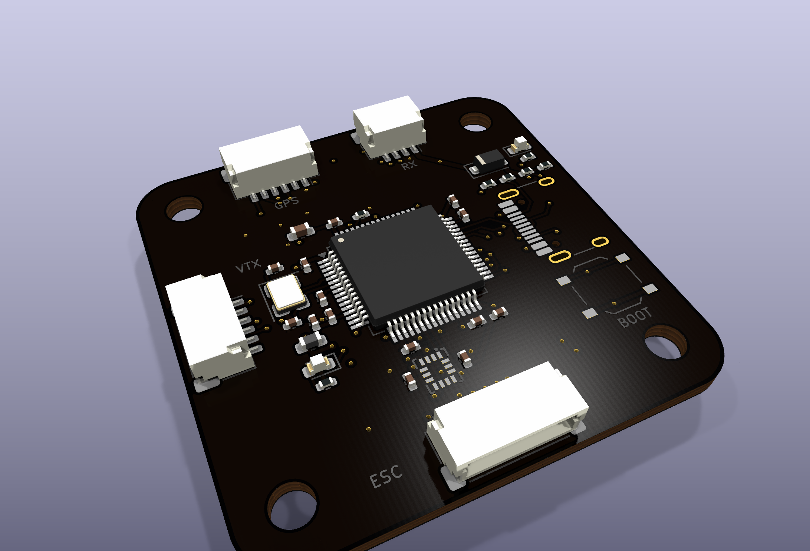
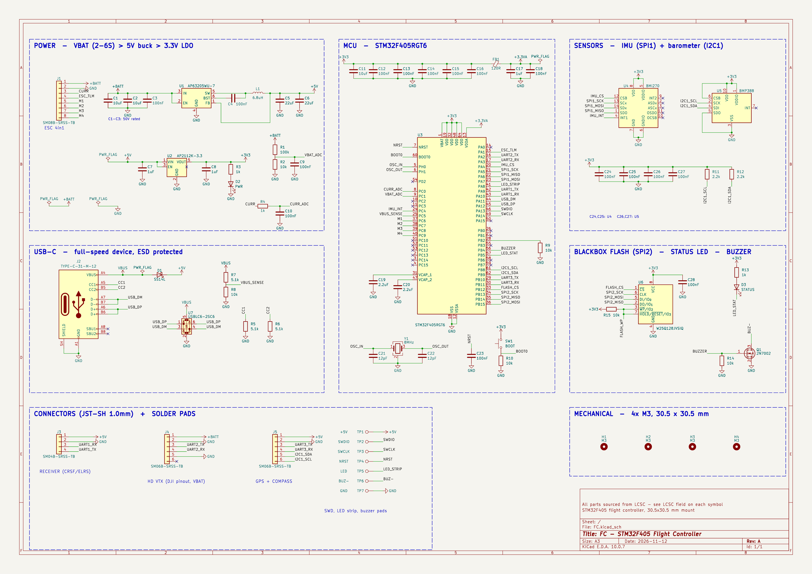
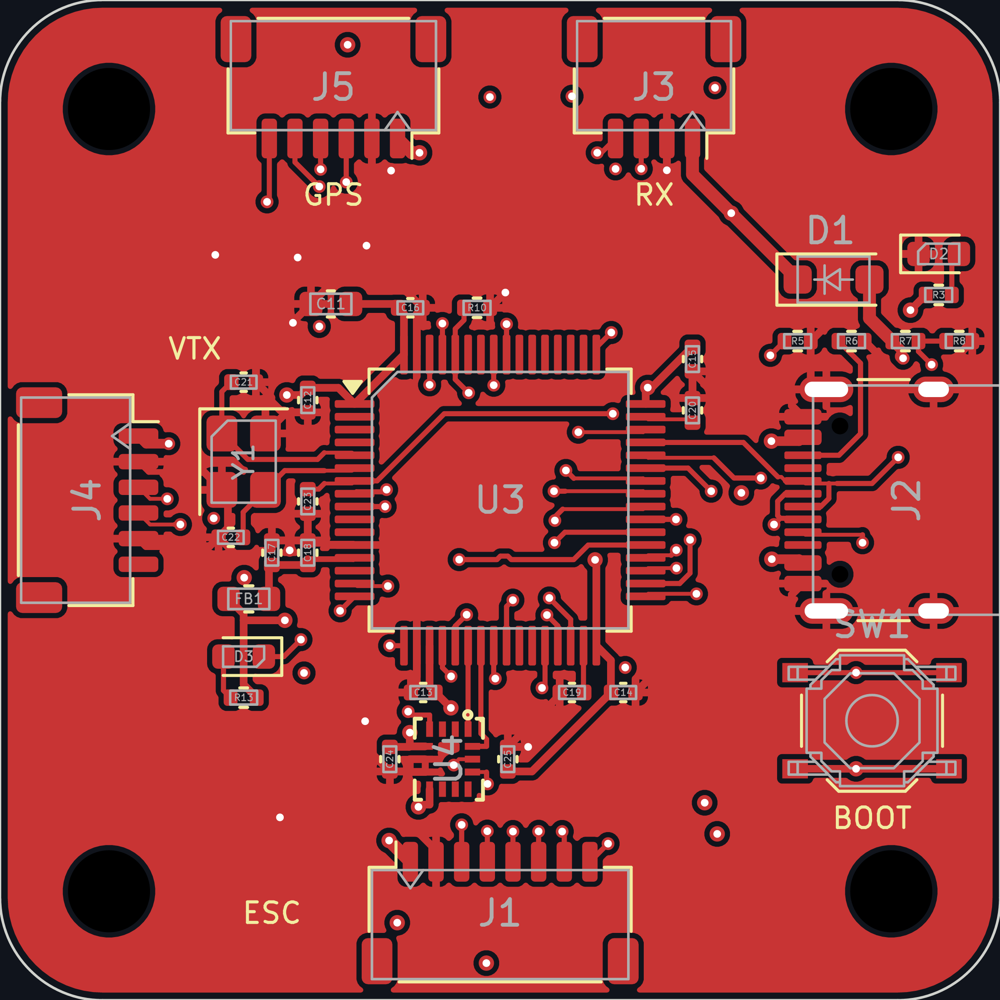
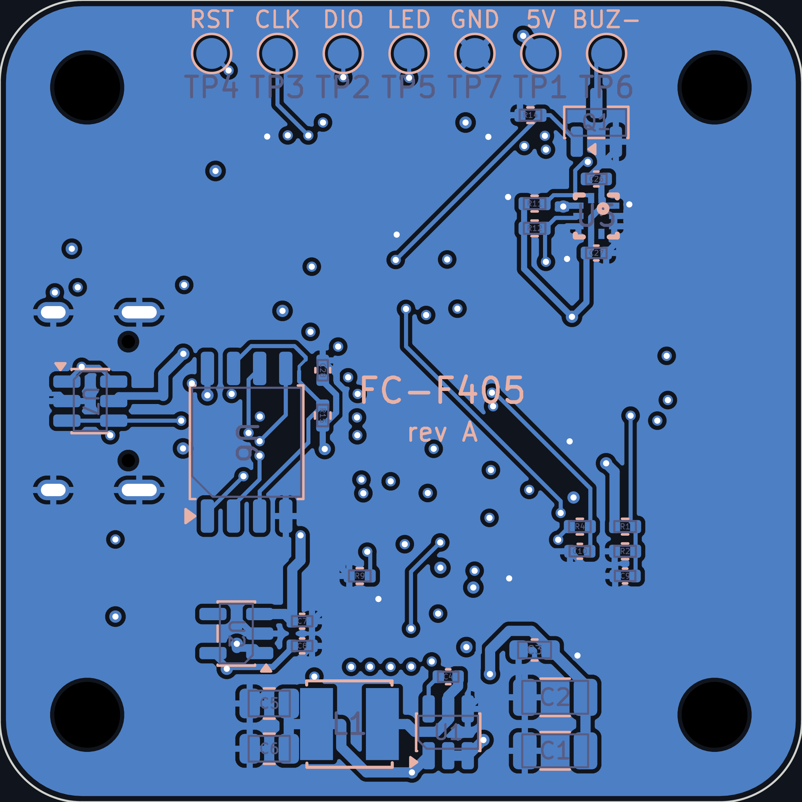
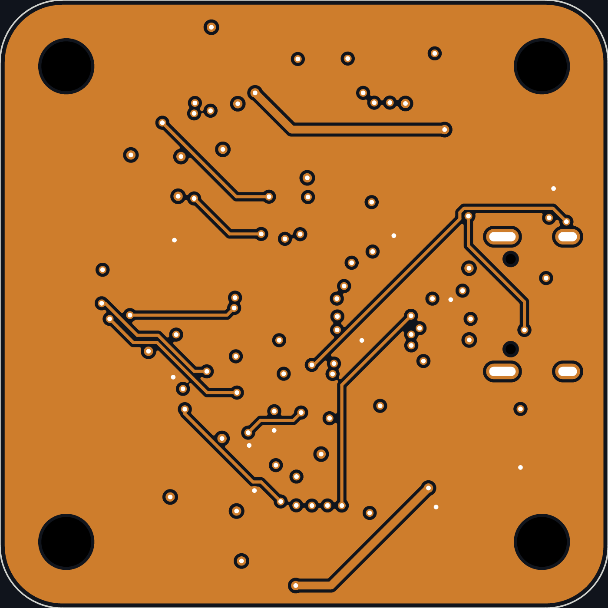
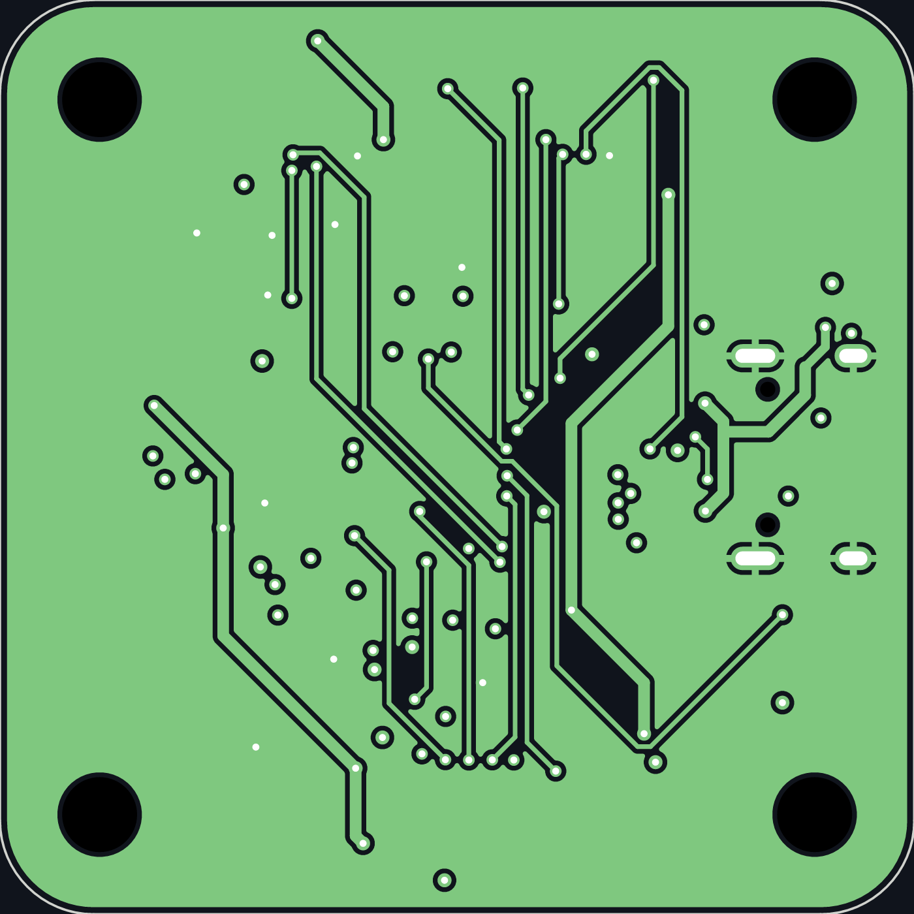
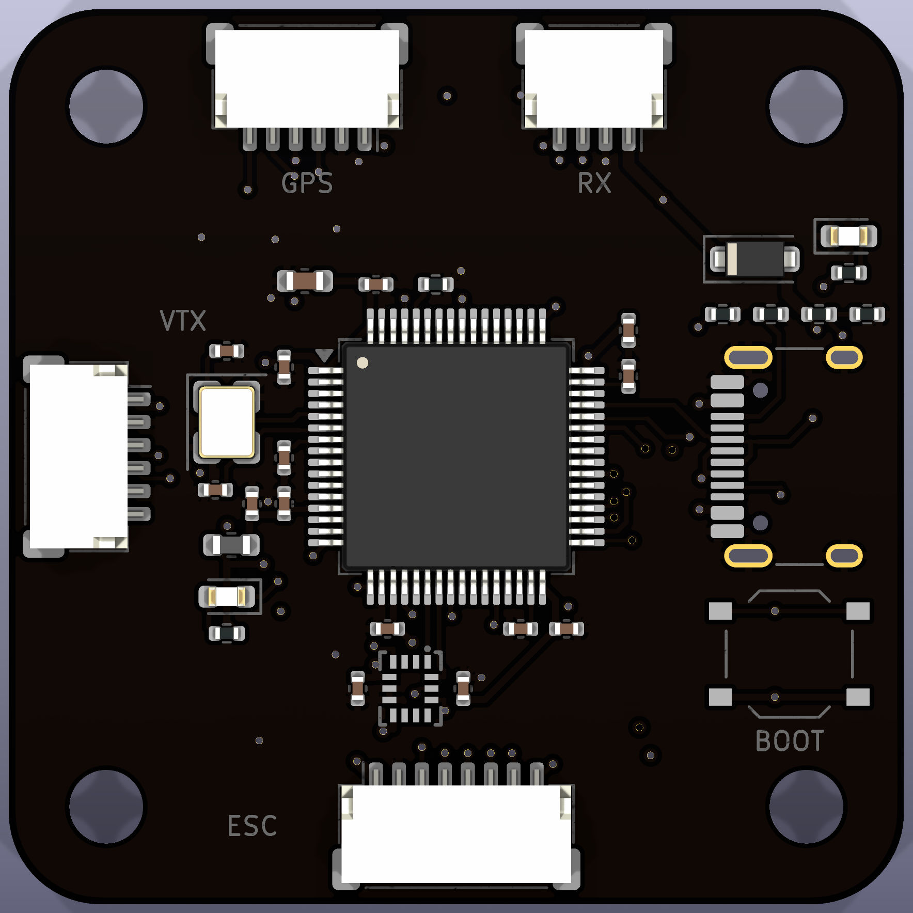
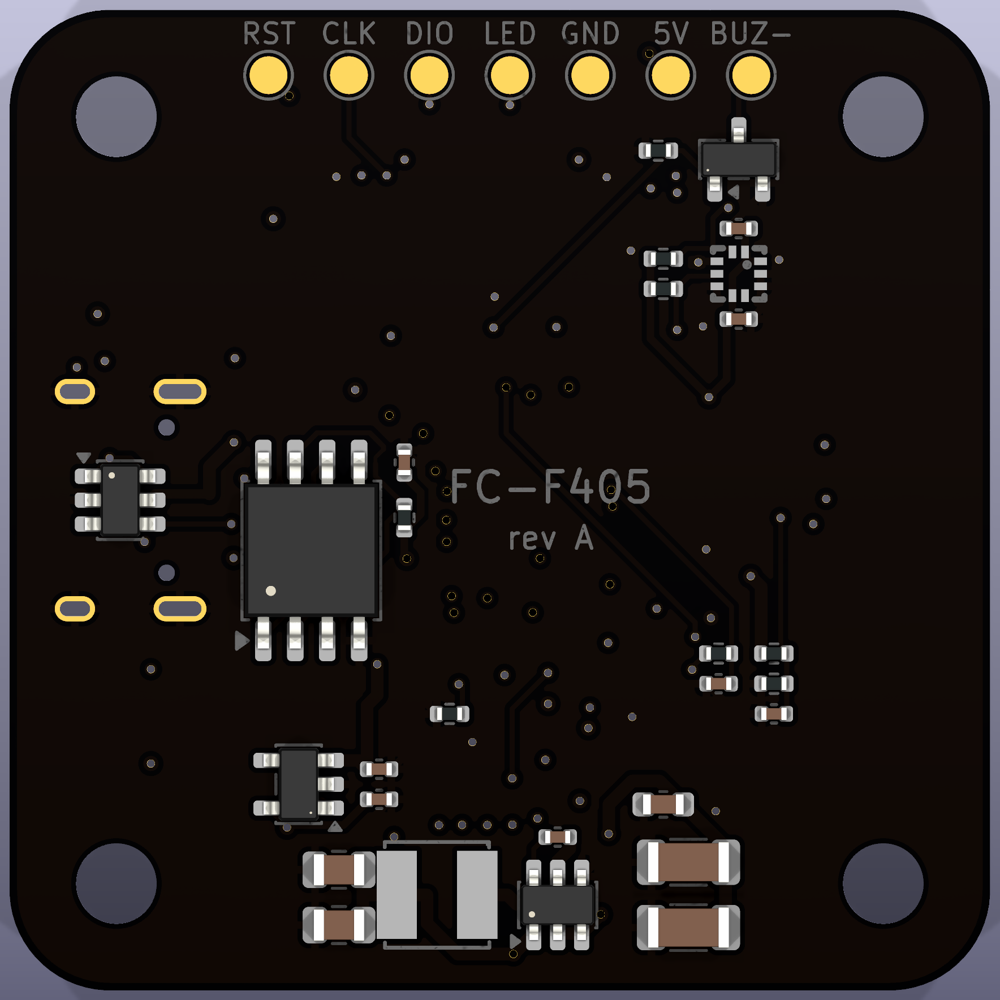

<h1 align="center">
  FC
   
</h1>
<h4 align="center">
An STM32F405 flight controller
</h4>

  <a href="#key-features">Key Features</a> •
  <a href="#pcb">PCB</a> •
  <a href="#credits">Credits</a>

&nbsp;

# FC

FC is a 39 × 39 mm flight controller for multirotors, built around the STM32F405RGT6, with a 30.5 × 30.5 mm M3 mounting pattern.

it has a BMI270 gyro, a BMP388 barometer, 16 MB of blackbox flash and a 2S–6S power stage on one 4-layer board. connectors are JST-SH for a 4-in-1 ESC, receiver, HD VTX and GPS, plus USB-C.

to build your own, grab the KiCad files in `pcb/`, check the schematic and BOM, and send the Gerber files in `production/` to your preferred PCB manufacturer. the MCU can be flashed over USB (hold BOOT while plugging in) or through the SWD pads.

## Key Features

* **STM32F405RGT6** MCU, 168 MHz Cortex-M4
* **BMI270** 6-axis IMU on SPI
* **BMP388** barometer on I2C
* **W25Q128** 16 MB blackbox flash
* **2S–6S input** with an AP63205 5 V / 2 A buck and AP2112K 3.3 V regulator
* **USB-C** with ESD protection using USBLC6-2SC6
* **4 motor outputs**, ESC telemetry, battery voltage and current sensing
* **3 UARTs** broken out: receiver, HD VTX, GPS (with I2C for a compass)
* **Solder pads** for SWD, LED strip and buzzer
* **4-layer PCB** designed in KiCad, all parts available from LCSC

## PCB

designed in KiCad with a 4-layer stackup: signals on the outer layers, a solid ground plane and a 3.3 V plane inside.

the connectors sit on the board edges with the MCU in the centre. the gyro is right below the MCU's SPI pins, and the buck converter, regulator, flash and barometer are on the bottom side.

## Files

the repository includes the KiCad project files, schematics, BOM, Gerber exports and component placement files.

| Folder | Contents |
|---|---|
| `pcb/` | KiCad project, schematic, board, project symbol and footprint libraries |
| `docs/` | schematic PDF |
| `images/` | progress and final renders |
| `production/` | Gerber zip and pick-and-place file |
| `BOM.csv` | bill of materials with LCSC part numbers |
| `journal.md` | build log |
| `journals/` | the KiCad files and screenshots at each of the 15 design steps |
### Schematic

---

### PCB Layers

#### F.CU

#### B.CU

## PWR

## GND

---

### Board Views

#### Front

#### Back

### ZINE

## Credits

This project uses:
- [KiCad](https://www.kicad.org/)

## License

GPL
