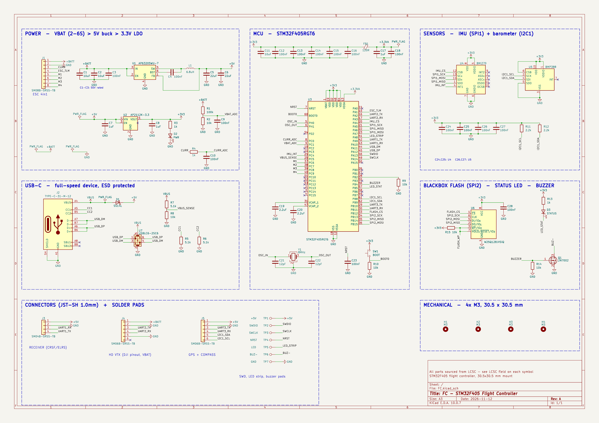
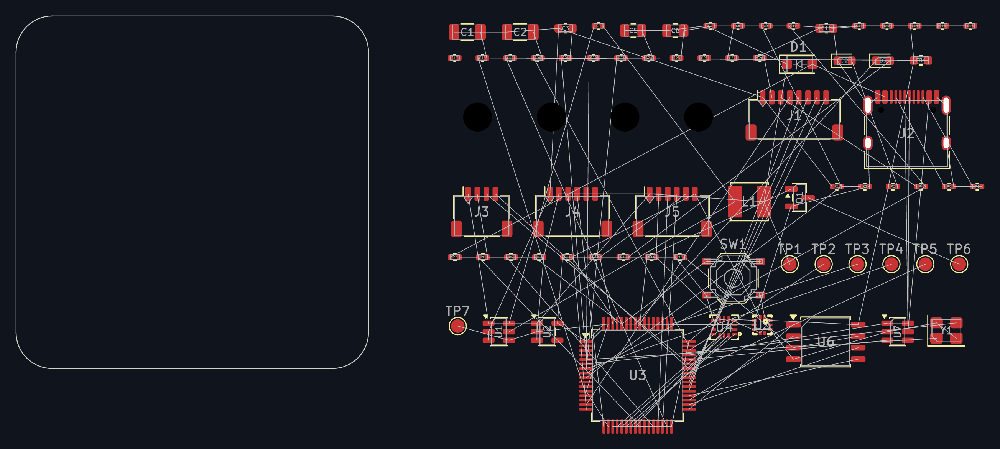
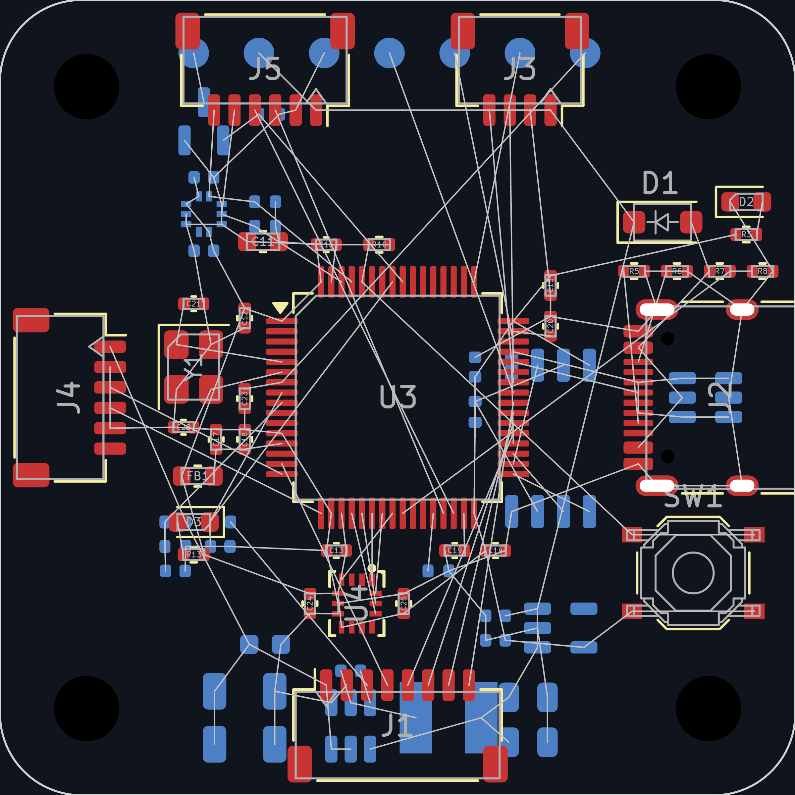
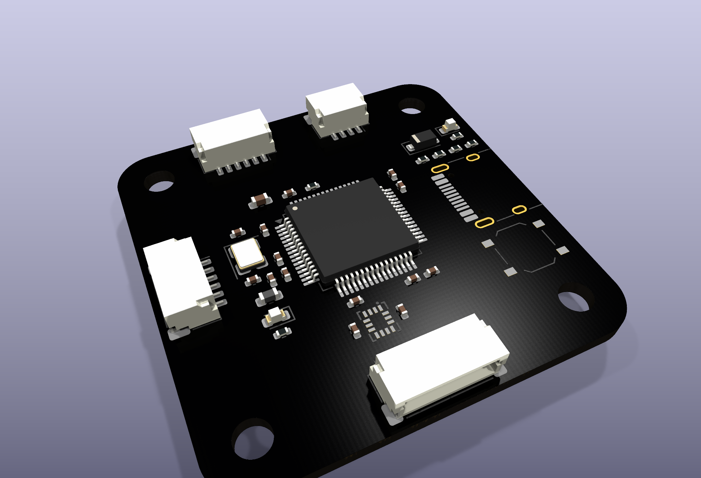
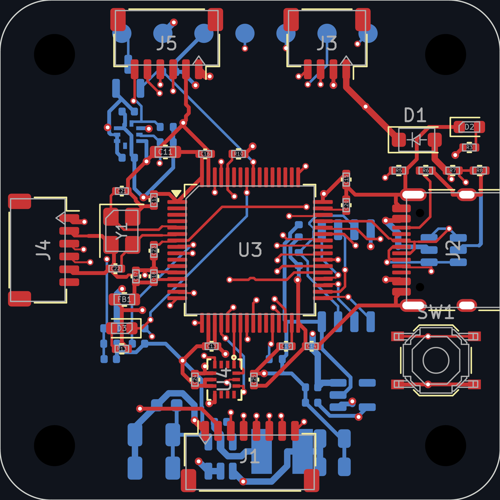
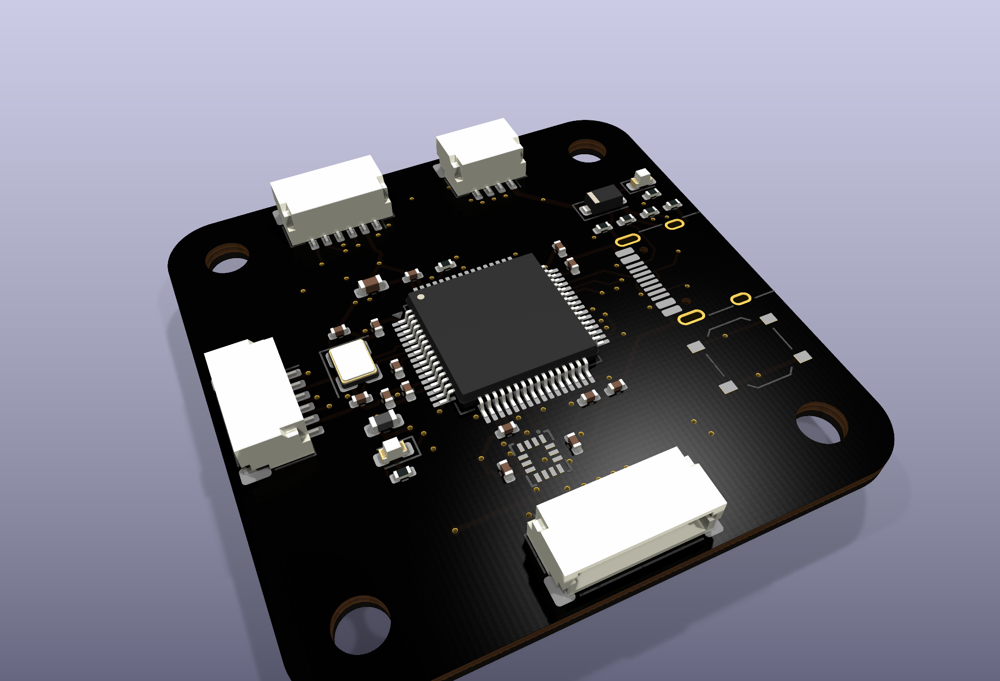
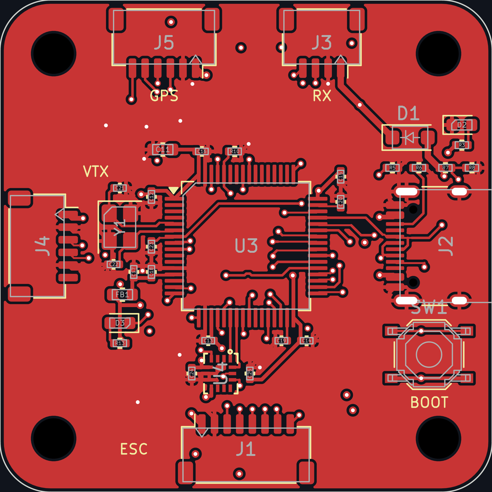
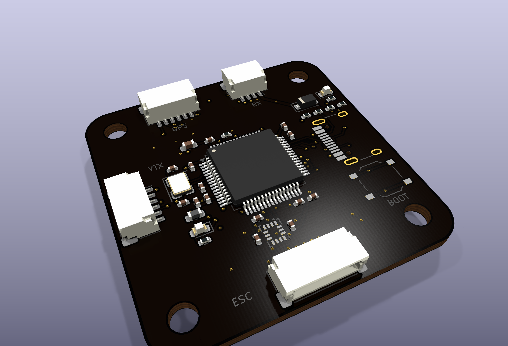

### TOTAL TIME: 46 HOURS

## November 4 | getting started | 4h

okay so i've been wanting to make a flight controller PCB and finally started working on it

started looking at existing flight controllers and what parts id need. wanted to make something that works with Betaflight, INAV and ArduPilot.

also started looking into the MCU, gyro, barometer and the power setup. wanted to keep the board around the usual 30.5mm mounting pattern.

## November 4 | picking parts | 3h

spent some more time looking for parts on LCSC

for the main chip i decided to use the STM32F405RGT6 since its supported by most flight controller firmware.

initially wanted to use the ICM-42688-P for the gyro but there were only 3 in stock and it cost $21.80 lol. went with the BMI270 instead which was much cheaper at $2.38.

also picked the BMP388 since the other barometers i looked at were out of stock.

## November 5 | power setup | 4h

worked on figuring out the power setup today

the board will get power from the battery through the ESC connector. went with an AP63205 to get 5V from the 2S-6S battery and an AP2112K for 3.3V.

also added a schottky diode so USB can power the board too.

spent some time checking the parts and their prices on LCSC. didnt want to use something that i cant even order later.

## November 5 | more parts and datasheets | 3h

went through the datasheets and checked the parts again

also looked at the USB-C connector, flash and all the other small parts needed around the MCU.

started making a rough list of all the connections id need in the schematic. this helped a bit before actually putting everything together in KiCad.

## November 6 | starting the schematic wiring | 4h

finally started working on the schematic wiring in kicad

got the parts onto the sheet and split everything into sections so it doesnt turn into a huge mess.

got 74 parts in total including the power section, USB, MCU, sensors, flash and connectors.

started connecting the power section first and then moved onto USB.

## November 6 | MCU and USB | 3h

continued with the schematic

got the USB-C connections sorted and started wiring the STM32F405.

added the crystal, reset and boot connections along with the small capacitors around the chip. also started adding the connectors for ESC, GPS, receiver and VTX.

still had the sensors and flash left to do.

## November 7 | sensors and flash | 3h

worked on the sensor part today

added the BMI270 gyro, BMP388 barometer and external flash.

connected everything to the MCU and checked the datasheets while doing it. wanted to keep the gyro close to the MCU when placing everything on the PCB later.

## November 7 | finishing the schematic | 3h

spent some more time checking the whole schematic

went through the power, USB and MCU connections again and fixed a few things.

also ran ERC in kicad and got 0 errors and 0 warnings!

heres the schematic

finally moved onto the PCB

## November 8 | PCB outline and parts | 3h

started the PCB layout today

made a 39 x 39mm board with 4 layers and M3 holes using the 30.5mm mounting pattern.

imported all the parts and started placing them around the board. didnt focus too much on the exact positions yet, just wanted to see how everything would fit.

heres the initial layout

## November 8 | placing everything | 2h

spent some more time moving things around

put USB-C on the right, ESC at the bottom, GPS and receiver on top and VTX on the left.

placed the STM32 in the middle and kept the gyro close to it. also moved the power parts, flash and barometer to the bottom.

## November 9 | fixing the placement | 3h

continued working on the placement

added the small capacitors around the MCU, moved the crystal closer to its pins and sorted out the USB resistors and LEDs.

took a while to get everything to fit properly but its looking much better now.

## November 9 | setting up 4 layers | 2h

started setting up the copper layers

since this is a 4 layer board i decided to use the two inner layers for ground and 3.3V.

this brought the ratsnest from 187 lines down to 94 which is pretty nice.

## November 10 | starting routing | 2h

finally started routing the PCB

used Freerouting to connect most of the parts. first try left 3 connections unfinished because some of the ground and 3.3V lines were using too much space.

spent some time figuring out what was wrong and changed their track widths.

## November 10 | fixing the routing | 2h

tried routing again with smaller widths and vias

finally got 0 unfinished connections!

heres how the board looks rn

still needed to clean up the board and add the final ground fills.

## November 11 | final PCB work | 3h

spent some more time cleaning everything up

added ground fills on both outer layers which also connected the last 2 ground pads. added labels for the connectors and solder pads too.

ran DRC and went through the results. got 0 unconnected parts and 0 schematic mismatches. there was just 1 warning because the USB-C label was cut where the connector goes over the board edge.

## November 12 | final renders | 2h

got the final checks and renders done today

heres the final copper

and the final 3D render

pretty happy with how this turned out! managed to fit everything into a 39 x 39mm board.

havent ordered or tested the PCB yet so still need to check the actual board and make sure everything works.

## misc
I ALSO MADE ZINE :D NOT COUNTING THE HOURS BECAUSE I FORGOT

TYSM FOR READING TILL HERE!!
